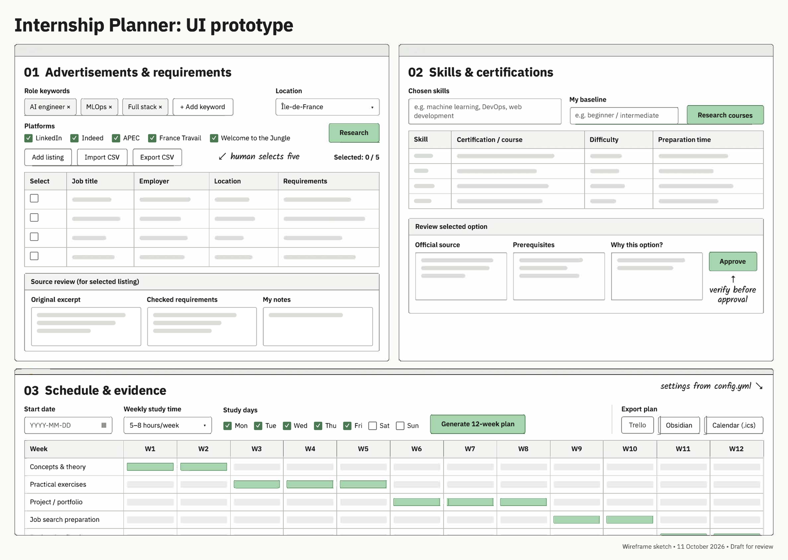
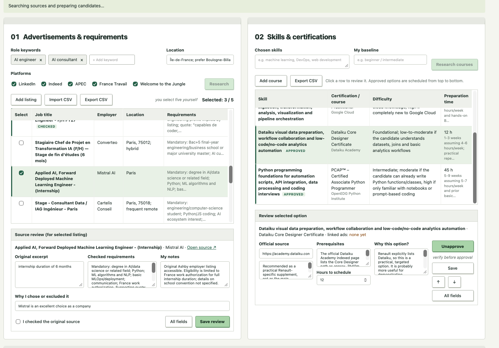
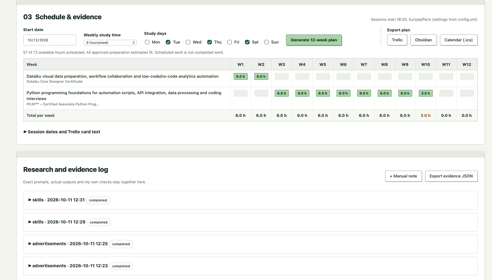

<div align="center">

# 🧭 Internship Planner

### A local planning tool for comparing AI internship advertisements, closing skill gaps and scheduling 12 weeks of preparation

[](https://www.python.org/)
[](https://developer.mozilla.org/en-US/docs/Web/JavaScript)
[](config.yml)
[](https://platform.openai.com/)
[](https://pytest.org/)


</div>

---

## 📖 Overview

I am studying for a B.Sc. in Applied Artificial Intelligence at IU and plan a six-month AI engineering internship during my master's, ideally near Boulogne-Billancourt or Paris 16. This project started from one question:

> **Which skills should I prioritise for that internship, and how can I organise the learning within five to eight hours per week?**

The planner brings the three steps of that decision into one page: collecting and checking advertisements, comparing my skills with what they ask for, and turning approved learning options into a dated 12-week plan. AI research is optional and every suggestion stays unapproved until I review it.

> 🎓 **Course:** Project: AI Fluency - Introduction to Generative AI (DLBPKIEKPT01-01_E) · B.Sc. Applied Artificial Intelligence
> 🏫 **IU International University of Applied Sciences**

---

## 🗺️ How It Works

The page follows the order in which I plan. I sketched this layout myself before any AI worked on the interface:

<div align="center">


<sub>My wireframe, 11 October 2026 (<a href="docs/wireframe.pdf">PDF version</a>). The finished interface follows these three panels.</sub>

</div>


| | Panel | What happens there |
|:---:|---|---|
| 📋 | **01 · Advertisements & requirements** | Role keywords, location and platform filters; an advertisement table where I select five roles; a source review box with the original excerpt, checked requirements, my notes and why I chose or excluded the role |
| 🎯 | **02 · Skills & certifications** | My chosen skills and baseline; a table of courses and certifications with difficulty and preparation time; a review box (official source, prerequisites, why this option) before I approve anything |
| 📅 | **03 · Schedule & evidence** | Start date, weekly hours (5 to 8) and study days; a W1 to W12 grid with one row per approved option; export to Trello, Obsidian and calendar |
| 🗂️ | **Research & evidence log** | Every AI request with its exact prompt and full answer, kept below the panels so it can be reviewed later |

> [!NOTE]
> Checking sources is a human task. A "checked" flag records my decision; it does not prove that every extracted requirement is correct. Likewise, a generated schedule is a plan, not completed learning.

---

## 🖼️ Screenshots

<div align="center">


<sub>Panels 01 and 02 during an early session (11 October 2026): three of five roles selected, source review open for the Mistral AI listing</sub>

<br><br>


<sub>Panel 03 and the research log: an earlier draft plan (57 of 72 hours) before I changed my learning options</sub>

</div>

---

## 📅 Current Learning Plan

After comparing five advertisements and rating my own skills, I kept three options:

<div align="center">

| Option | Why | Hours | Weeks |
|---|---|:---:|:---:|
| 🤖 **Hugging Face Agents Course** | Agents and LLM tools appear in all five roles | 35 | 1 to 6 |
| 🏭 **Machine Learning in Production** | I have no real experience with deployment yet | 24 | 6 to 10 |
| 🔥 **PyTorch: Learn the Basics** (core tutorials) | Named in two roles; I still need help with it | 19 | 10 to 12 |
| | **Total at 6.5 h per week** | **78** | **12** |

</div>

I first approved **GitHub Foundations** because it looked more reputable than documentation. Once I rated my own skills, that choice did not hold up: I already use Git independently, while PyTorch is a real gap. It moved to the backlog.

---

## 🏗️ Architecture

```text
 Browser (web/)                 Python application (src/internship_planner/)
 ┌──────────────────┐   HTTP    ┌────────────────────────────────────────────────┐
 │ index.html       │ ────────▶ │ app.py ──▶ repository.py ──▶ data/project.json  │
 │ app.js           │ ◀──────── │   │                                            │
 │ style.css        │   JSON    │   ├──▶ scheduler.py      (12-week allocation)  │
 └──────────────────┘           │   ├──▶ research.py ──▶ integrations/openai     │
                                │   └──▶ exporters/        (Trello · Obsidian ·  │
                                │                           calendar · CSV)      │
                                └────────────────────────────────────────────────┘
```

| File | Responsibility |
|---|---|
| `app.py` | Local HTTP server (Python standard library), routes browser requests |
| `config.py` | Reads and validates `config.yml` |
| `models.py` | What an advertisement, learning option and study session contain |
| `repository.py` | Loads and saves the project as JSON, with change history |
| `scheduler.py` | Turns approved options and weekly hours into dated sessions and reports overflow |
| `research.py` · `integrations/openai_client.py` | Builds research prompts, calls the API, validates returned candidates |
| `exporters/` | CSV, calendar (ICS), Obsidian Markdown and Trello card output |
| `web/` | The three-panel interface |

---

## 🗃️ Data Model

All records live in one JSON file, `data/project.json`, which is ignored by Git.

| Record | Main fields |
|---|---|
| 📋 **Advertisement** | title, employer, location, duration, source URL, original excerpt, requirements, review, selection reason, checked / selected |
| 🎯 **Learning option** | skill, linked advertisements, course or certification, issuer, difficulty, preparation hours, source, prerequisites, review, approved |
| 📅 **Study session** | option, start, end, activity, expected evidence |
| 🗂️ **Research record** | task, exact prompt, model, raw response, sources, my corrections |

---

## ▣ Project Structure

```text
internship-planner/
├── README.md
├── CONFIGURATION.md            # every setting in config.yml explained
├── config.yml                  # weekly hours, study days, location, prompt templates
├── requirements.txt            # PyYAML (runtime) · pytest (tests)
├── Launch.command              # double-click start on macOS
├── src/internship_planner/
│   ├── app.py · config.py · models.py · repository.py
│   ├── scheduler.py · research.py
│   ├── integrations/openai_client.py
│   ├── exporters/              # csv · calendar · obsidian · trello
│   └── web/                    # index.html · app.js · style.css
├── tests/                      # 15 tests: repository, scheduler, research, exporters, HTTP
├── data/
│   ├── sample-project.json     # fictional demo data
│   └── raw/import-template.csv # CSV template for bulk advertisement import
├── docs/
│   ├── wireframe.png · .pdf    # my original layout sketch
│   └── screenshots/
└── exports/                    # generated files (ignored by Git)
```

---

## ⚡ Quick Start

```bash
# 1️⃣ Clone the repository
git clone https://github.com/ApteryxDev/internship-planner.git
cd internship-planner

# 2️⃣ Create a virtual environment and install
python3 -m venv .venv
source .venv/bin/activate          # Windows: .venv\Scripts\activate
pip install -r requirements.txt

# 3️⃣ (optional) load the fictional demo data
cp data/sample-project.json data/project.json

# 4️⃣ Start the planner
PYTHONPATH=src python -m internship_planner.app
```

The browser opens at **http://127.0.0.1:8765**. On macOS you can also double-click `Launch.command`. Use `--port` or `--no-browser` to change the start-up behaviour.

> [!TIP]
> Manual entry, CSV import, scheduling and all exports work **without an API key**. For AI research, enter your OpenAI key in the app's Settings dialog or set `OPENAI_API_KEY` before starting. The key is held in memory only and never written to a file.

---

## ⚙️ Configuration

Defaults live in [`config.yml`](config.yml) and are explained in [CONFIGURATION.md](CONFIGURATION.md): weeks, weekly hour limits, study days, session start time and timezone, location preference, research model and the prompt templates. The research template tells the model to keep source excerpts short, to separate proctored credentials from completion certificates, and not to claim employer recognition without evidence.

---

## ✓ Testing

```bash
python -m pytest tests -q
```

<div align="center">

| Test file | Covers |
|---|---|
| `test_repository.py` | Empty and invalid JSON, atomic saves, the five-selection limit, approval only after a checked source |
| `test_scheduler.py` | Weekly capacity and overflow, Paris daylight-saving shifts, invalid times |
| `test_research.py` | Prompts built from selected ads, saved prompts, de-duplication, keeping bad responses |
| `test_exporters.py` | All export formats, quoted CSV fields and protection against spreadsheet formulas |
| `test_http.py` | A full browser workflow and CSV import through the local server |

</div>

---

## 🛠️ How It Was Built

<details>
<summary><b>🔍 Click for the rebuild story</b></summary>
<br>

**Why I rebuilt it.** My first prototype, made with Codex, worked, but I could not always say why a piece of code was where it was. Before rebuilding I set myself two rules:

1. Write down what I want in my own words first.
2. Sketch the interface **before** any AI touches it.

**Where the old code went.** Nothing was deleted silently. The working parts were moved into the package:

| From the prototype | New location |
|---|---|
| Web page (HTML, CSS, JS) | `web/` |
| Data handling and saving | `models.py`, `repository.py` |
| Scheduling logic | `scheduler.py` |
| AI research call | `research.py`, `integrations/openai_client.py` |
| Export functions | `exporters/` |

**The interface rebuild.** I gave Claude my wireframe, the project, my Phase 1 concept and the tutor's feedback, so that the new page would follow my layout and address the feedback in one pass. The three-tab layout became one page with my three panels; the Python logic was not changed. Two things differ from my sketch and are still open decisions: the 12-week grid is organised by learning option rather than by type of activity, and the location field is free text rather than a fixed list. One addition did not come from my sketch: a warning when two selected advertisements share an employer, which answers the tutor's comment about choosing overly similar positions.

</details>

---

## 🤝 Contributions and AI Assistance

This project was part of a course about using AI critically, so I record who did what.

<div align="center">

| 👤 **My own work** | 🤖 **AI-assisted work** |
|---|---|
| Goal, guiding question, location and workload limits | First working prototype (**Codex**) |
| The wireframe and the order of the three panels | Reorganisation into a Python package and the test suite (**ChatGPT**) |
| Class structure, variable types and the YAML configuration approach | Interface rebuild following my wireframe (**Claude**) |
| Selecting the five advertisements and writing my reasons | Candidate advertisements and learning options through the planner (**OpenAI API**) |
| Approving options and replacing GitHub Foundations with PyTorch | Source and issuer page checks, schedule regeneration, Trello set-up and documentation (**Codex**) |
| Rating my own skills | Repository review, document templates and README editing (**Claude**) |

</div>

I estimate that my recent projects are roughly half independent and half AI-assisted. That is a rough figure looking back, not a measurement, and I do not claim authorship of individual lines beyond what is listed above.

---

## ⚠️ Limitations

- The source text stored for each advertisement is a short excerpt; full pages must still be checked by hand.
- Research results reflect only what the model could access, so "no listing found" says nothing about the real market.
- Preparation hours are estimates. A generated schedule shows planned work, not completed learning.
- JSON storage is designed for one person and a small amount of data, not as a shared database.

---

## 🛠️ Built With

<div align="center">

| Tool | Used for |
|---|---|
| 🐍 **Python 3.10+** (standard library HTTP server) | Application and API |
| 📄 **PyYAML** | Configuration |
| 🌐 **HTML · CSS · JavaScript** | Interface |
| 🧪 **pytest** | Tests |
| 🤖 **OpenAI API** (optional) | Research requests |

</div>

---

<div align="center">

**🎓 Built for IU International University of Applied Sciences**
*B.Sc. Applied Artificial Intelligence · Project: AI Fluency - Introduction to Generative AI*

</div>
